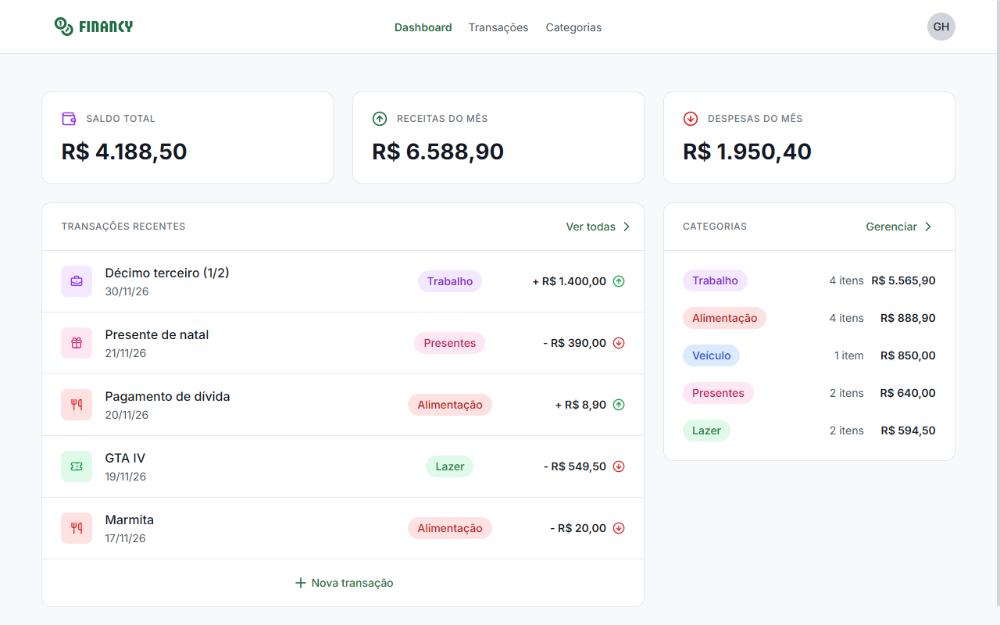

# Financy

Projeto avaliativo de conclusão da jornada **Expansão de Habilidades** da pós-graduação Tech Developer 360, da Rocketseat.



## Sumário

- [Sobre o projeto](#sobre-o-projeto)
- [Tecnologias utilizadas](#tecnologias-utilizadas)
- [Como o projeto foi desenvolvido](#como-o-projeto-foi-desenvolvido)
- [Executando a aplicação](#executando-a-aplicação)
- [Melhorias sugeridas](#melhorias-sugeridas)

## Sobre o projeto

O Financy é uma plataforma de gestão financeira pessoal. Depois de criar uma conta, o usuário acompanha em um painel o saldo total, as receitas e despesas do mês, as últimas transações e quanto movimentou em cada categoria. Também pode cadastrar, editar e excluir categorias e transações, além de buscar e filtrar as transações por tipo, categoria e período.

A interface foi entregue no [Figma](https://www.figma.com/community/file/1580994817007013257/financy) e orienta a construção visual de 6 telas e 2 janelas de sobreposição.

## Tecnologias utilizadas

### Back-end

O servidor foi construído em Node.js com TypeScript e Express. As consultas GraphQL são atendidas pelo Apollo Server, com o schema gerado pelo TypeGraphQL a partir das classes do projeto. Os dados ficam em um banco SQLite, acessado por meio do Prisma. A autenticação é feita com JWT, e as senhas são armazenadas com hash gerado pelo bcrypt.

### Front-end

A interface segue fielmente o protótipo e foi construída com React e Vite. As rotas são servidas pelo React Router, a comunicação com a API é feita pelo Apollo Client e o estado de autenticação fica no Zustand. Os componentes vêm do shadcn/ui, adaptados ao Style Guide do projeto, e a estilização foi feita com Tailwind CSS.

Nos dois projetos, o código é formatado e verificado pelo Biome.

## Como o projeto foi desenvolvido

O ponto de partida foram as aulas dos níveis **Back-end com GraphQL** e **Front-end com GraphQL**, da terceira jornada da pós-graduação. Como as aulas foram gravadas há mais de um ano, boa parte das bibliotecas e ferramentas já está em versões mais recentes, então a adaptação do código se apoiou na documentação oficial de cada uma delas e em pesquisas na internet.

Ferramentas de inteligência artificial serviram apenas para tirar dúvidas e revisar problemas. Todo o código foi escrito manualmente.

## Executando a aplicação

É necessário ter o [Node.js](https://nodejs.org/) 24 ou superior instalado. Depois de clonar o repositório, o back-end e o front-end devem ser executados em terminais separados.

### Back-end

Instale as dependências e crie o arquivo de variáveis de ambiente:

```bash
cd backend
npm install
cp .env.example .env
```

Em seguida, preencha o `.env`:

| Variável       | Descrição                                 | Exemplo                 |
| -------------- | ----------------------------------------- | ----------------------- |
| `DATABASE_URL` | Caminho do banco SQLite                   | `file:./dev.db`         |
| `JWT_SECRET`   | Chave usada para assinar os tokens        | Um texto aleatório      |
| `FRONTEND_URL` | Endereço do front-end autorizado no CORS  | `http://localhost:5173` |

Por fim, crie o banco de dados e inicie o servidor:

```bash
npm run migrate
npm run dev
```

A API ficará disponível em `http://localhost:4000/graphql`.

### Front-end

Instale as dependências e crie o arquivo de variáveis de ambiente:

```bash
cd frontend
npm install
cp .env.example .env
```

Em seguida, preencha o `.env`:

| Variável           | Descrição               | Exemplo                         |
| ------------------ | ----------------------- | ------------------------------- |
| `VITE_BACKEND_URL` | Endereço da API GraphQL | `http://localhost:4000/graphql` |

Por fim, inicie a aplicação:

```bash
npm run dev
```

A aplicação ficará disponível em `http://localhost:5173`.

## Melhorias sugeridas

O desenvolvimento se concentrou em cumprir todos os critérios de avaliação do enunciado do desafio. Ainda assim, alguns pontos que não foram solicitados precisariam ser trabalhados para que a aplicação se tornasse um produto viável:

- [ ] **Skeletons de carregamento:** exibir placeholders enquanto os dados são consultados no back-end.
- [ ] **Refresh token:** tornar as sessões mais seguras, com tokens de acesso de curta duração renovados automaticamente enquanto o usuário continua usando a aplicação.
- [ ] **Layout responsivo:** adaptar a interface para todos os tamanhos de tela.
- [ ] **Ferramentas de apoio ao desenvolvimento:** adotar bibliotecas como Zod e React Hook Form para validação e gerenciamento de formulários.
- [ ] **Arquivos-guia para IA:** caso seja do interesse de quem mantém o projeto, adicionar arquivos como `AGENTS.md` e `CLAUDE.md`.
- [ ] **Prevenção de erros:** aplicar padrões de UX que evitem ações acidentais, como pedir confirmação antes de excluir um registro.
- [ ] **Opções da tela de login:** tornar funcionais a recuperação de senha e a opção "Lembrar-me".
- [ ] **Relatórios:** permitir que o usuário exporte relatórios dos seus gastos, com filtros.
- [ ] **Campo de valor:** aplicar uma máscara monetária no valor da transação, que hoje é validado apenas como número.
- [ ] **Filtros e paginação no back-end:** como os filtros e a paginação apareciam apenas no protótipo, sem exigência no enunciado, eles foram implementados direto no front-end para simplificar o desenvolvimento. Com o crescimento do volume de registros, o ideal é que a API assuma essa responsabilidade.
